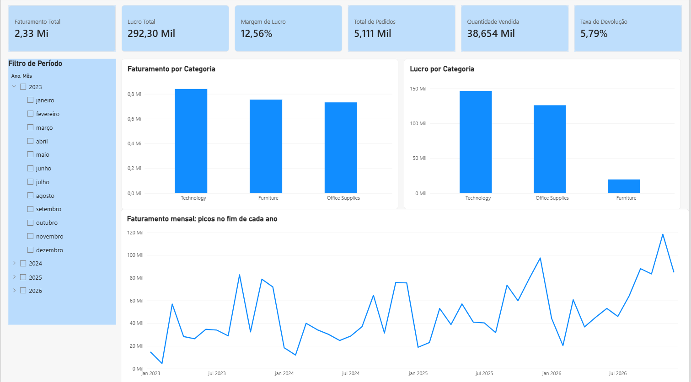
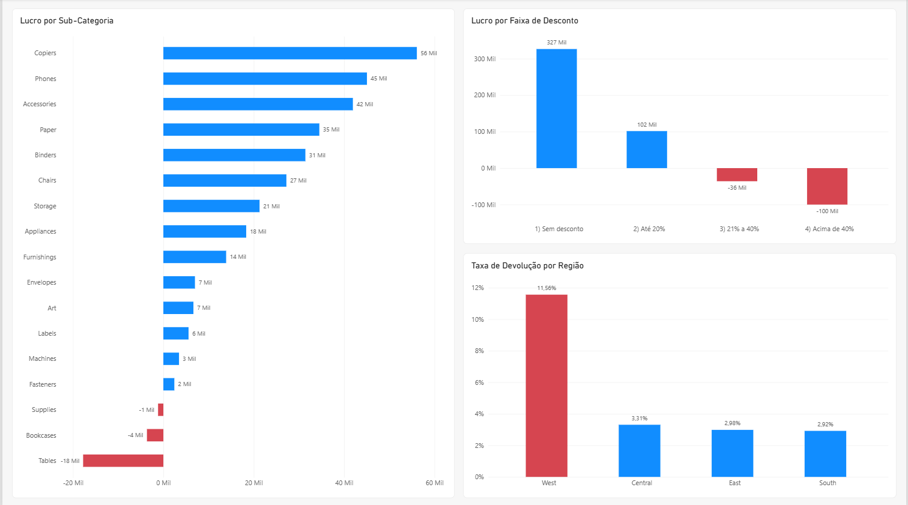

# Análise de Vendas e Lucratividade: Superstore (Power BI)

Dashboard em Power BI que analisa as vendas de uma varejista fictícia (dataset *Sample Superstore*) para responder uma pergunta central: **onde a empresa ganha e onde perde dinheiro, e por quê?**

> **Autor:** _[Franciele Cristina da Silva Santos]_ · **Contato:** _[francielecristinad83@gmail.com]_

---

## Visão geral do dashboard

### Página 1: Visão geral


### Página 2: Desconto, prejuízo e devoluções


---

## Objetivo

Entender o desempenho comercial (faturamento, lucro, margem, pedidos e devoluções) e identificar as causas dos produtos e regiões que dão prejuízo.

## Dados

- **Fonte:** Sample Superstore (arquivo Excel com 3 abas).
- **Orders:** 10.194 linhas e 21 colunas (pedido, data, cliente, região, categoria, vendas, quantidade, desconto, lucro).
- **Returns:** 296 pedidos devolvidos.
- **People:** gerentes regionais.
- **Período:** jan/2023 a dez/2026.
- **Qualidade:** sem valores nulos, vendas e quantidades sempre positivas e descontos entre 0% e 80%.

## Ferramentas

- Power BI Desktop (modelagem de dados, medidas DAX e visualizações)
- Excel (fonte dos dados)

---

## Principais resultados

| Indicador | Valor |
|---|---|
| Faturamento total | 2,33 Mi |
| Lucro total | 292,3 Mil |
| Margem de lucro | 12,56% |
| Pedidos | 5.111 |
| Quantidade vendida | 38.654 |
| Taxa de devolução (pedidos) | 5,79% |

### 1. O desconto é o principal fator de prejuízo

| Faixa de desconto | Lucro |
|---|---|
| Sem desconto | +326,7 Mil |
| Até 20% | +101,6 Mil |
| 21% a 40% | -36,0 Mil |
| Acima de 40% | -100,0 Mil |

- Vendas com desconto de 30% ou mais somam **-136 Mil** de lucro.
- Sem essas vendas, o lucro total seria de cerca de **428 Mil** (46% maior).
- Nenhuma venda sem desconto deu prejuízo.

### 2. Furniture vende bem, mas lucra pouco
- Margem da categoria: **2,6%**, contra cerca de 17% em Technology e Office Supplies.
- O problema está concentrado em **Tables (-17,8 Mil)** e **Bookcases (-3,6 Mil)**, com descontos médios de 26% e 22%.
- Chairs e Furnishings são lucrativas.
- Em Office Supplies, a sub-categoria **Supplies** também dá prejuízo (-1,2 Mil).

### 3. A região Central tem a menor margem
- Margem de **7,9%**, contra 15% na região West.
- Cerca de 28% das vendas da Central têm desconto de 30% ou mais (nas outras regiões, cerca de 10%).
- Estados com prejuízo: Texas (-25,7 Mil), Ohio, Pennsylvania, Illinois, Colorado, North Carolina, Tennessee e Arizona.

### 4. As devoluções se concentram na região West
- A West tem **11,6%** de pedidos devolvidos; as outras regiões ficam em cerca de 3%.
- A West responde por cerca de 64% dos pedidos devolvidos.
- As devoluções representam 7,8% do faturamento.

### 5. Sazonalidade e crescimento
- Faturamento por ano: 494 Mil (2023), 473 Mil (2024), 614 Mil (2025) e 746 Mil (2026).
- Os meses mais fortes são setembro, novembro e dezembro; os mais fracos são janeiro e fevereiro.

---

## Recomendações (hipóteses a validar)

1. Revisar a política de desconto, em especial acima de 20%, que concentra o prejuízo.
2. Reavaliar preços e descontos de Tables e Bookcases.
3. Investigar os descontos praticados na região Central e nos estados com prejuízo.
4. Investigar a causa das devoluções na região West (produto, entrega ou qualidade).

---

## Como o dashboard foi construído

**Modelo de dados:** tabelas Orders, Returns e People. A relação entre Orders e Returns usa filtro cruzado nos dois sentidos, para que a taxa de devolução respeite os filtros de categoria e região.

**Medidas e colunas criadas (DAX):**

```DAX
Margem de Lucro = DIVIDE(SUM(Orders[Profit]), SUM(Orders[Sales]))

Faixa de Desconto = SWITCH(TRUE(),
    Orders[Discount] = 0, "1) Sem desconto",
    Orders[Discount] <= 0.2, "2) Até 20%",
    Orders[Discount] <= 0.4, "3) 21% a 40%",
    "4) Acima de 40%")
```

Também foram criadas medidas para Faturamento Total, Lucro Total, Total de Pedidos, Quantidade Vendida e Taxa de Devolução.

**Visuais:**
- Página 1: 6 cartões de indicadores, filtro de período, faturamento e lucro por categoria, evolução mensal do faturamento.
- Página 2: lucro por sub-categoria, lucro por faixa de desconto e taxa de devolução por região, com formatação condicional (vermelho para prejuízo).

## Aprendizados e desafios

- A taxa de devolução mostrou 16,27% ao filtrar Furniture, quando o valor real é 7,48%. A causa era a direção do filtro entre Orders e Returns. A correção foi mudar a direção do filtro cruzado para **Ambos**.
- Agrupar o desconto em faixas deixou claro um padrão que não aparecia nos gráficos por categoria.

## Limitações

- Os dados são de exemplo (fictícios); parte das datas de 2026 é posterior à data de criação do projeto.
- Há 2 pares de linhas idênticas em Orders, que podem ser compras repetidas e foram mantidas.
- A análise mostra associações, não causas comprovadas.

## Próximos passos

- Página 3: lucro por estado e matriz região × categoria.
- Medida de variação ano contra ano.
- Publicar o relatório online.

## Arquivos do repositório

```
├── README.md
├── projeto_analise_de_dados_PI.pbix
├── dados/
│   └── sample_-_superstoe.xls
└── imagens/
    ├── pagina1.png
    └── pagina2.png
```
